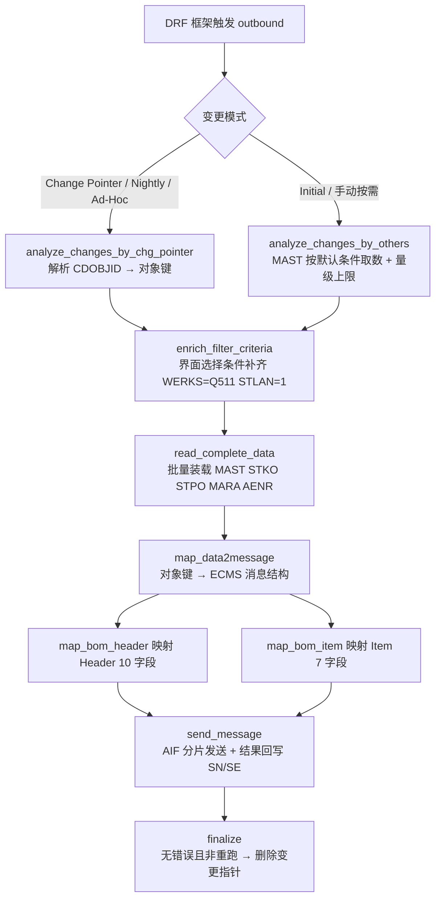
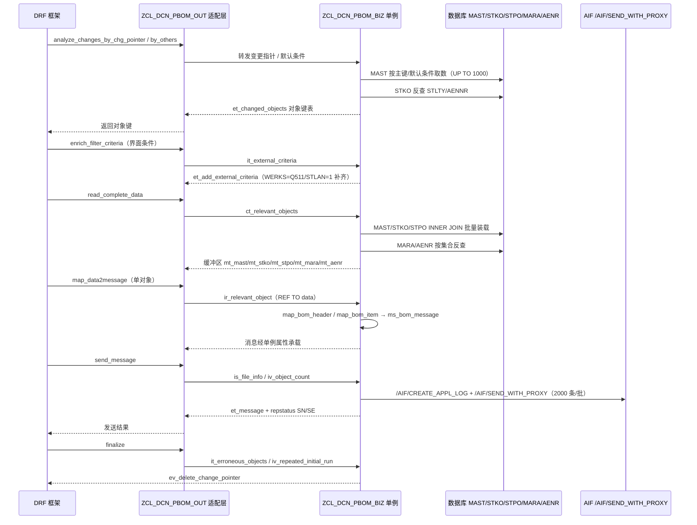

# ZCL_DCN_PBOM_BIZ 源码分析报告

**分析对象**：`dev/BOM_S4/zcl_dcn_pbom_biz.abap`（981 行）
**类全名**：`ZCL_DCN_PBOM_BIZ`（PUBLIC / FINAL / CREATE PUBLIC）
**配套文件**：`zcl_dcn_pbom_out.abap`（DRF 框架适配层）、`zcl_dcn_pbom_biz_test.abap`（ABAP Unit 测试）
**对应 FS**：`BOM SAP to ECMS interface (ZCN_ECMS / ZDCN_PBOM)`

---

## 一、程序定位与业务背景

### 1.1 解决什么问题

S/4HANA 的生产 BOM（Bill of Material）需要按接口协议同步到下游 **ECMS**（Engineering Change Management System）。DRF（Data Replication Framework）是 SAP 标准的出站复制框架，本类承载的就是 **DRF BOM 出站业务处理单例**——把 S4H 侧的生产 BOM 变更，经 DRF 生命周期钩子，转成 ECMS 协议消息并经 **AIF**（Application Interface Framework）发送出去。

类头部注释（第 1-5 行）点明职责：

```abap
*"! <p class="shorttext synchronized">DRF BOM 出站：业务处理单例（S4H → ECMS）</p>
*"!
*"! 承载全部业务逻辑：变更分析、过滤、批量取数、消息映射、AIF 发送、结果回写。
*"! 由框架适配层 ZCL_DCN_PBOM_OUT 通过 CLASS-DATA 单例引用调用。
*"! 对应 FS：BOM SAP to ECMS interface (ZCN_ECMS / ZDCN_PBOM)
```

**做什么** — 单例承载 DRF 出站全部业务逻辑：变更分析（Change Pointer / 初始加载双通道）、过滤条件补全、批量取数、BOM 数据到 ECMS 消息的字段映射、AIF 分片发送、结果状态回写与变更指针删除决策。

**为什么** — 刻意把业务逻辑与 DRF 生命周期解耦：`ZCL_DCN_PBOM_OUT`（适配层）只做 `IF_DRF_OUTBOUND` 接口的转发，不含任何业务；`ZCL_DCN_PBOM_BIZ` 是 `CREATE PUBLIC` 的普通单例，业务可独立单测（配套有 ABAP Unit 测试类）。这是"框架薄、业务厚"的典型分层。

**风险与改进** — 单例经 `CLASS-DATA mo_drf_bom_out` 持有（适配层第 18 行），若 DRF 框架并发跑多个 outbound 实例，单例的实例属性 `mt_mast/mt_stko/mt_stpo/mt_mara/ms_bom_*` 会被并发改写——`send_message` 里对同一批对象循环发送时依赖这些缓冲区，单对象单包（package_size=1）缓解了并发压力，但单例本身非线程安全，需在运行环境核实 DRF 是否串行调用（需核实）。

### 1.2 整体设计范式一句话定性

**DRF 出站钩子 + 单例业务核心 + AIF 代理发送**：`ZCL_DCN_PBOM_OUT` 实现 `IF_DRF_OUTBOUND`，每个生命周期回调把控制转给 `ZCL_DCN_PBOM_BIZ`；BIZ 内部以 `read_complete_data` 批量装载 MAST/STKO/STPO/MARA/AENR 到实例缓冲区，`map_data2message` 按对象键从缓冲区拼装 ECMS 消息，`send_message` 经 `/AIF/SEND_WITH_PROXY` 分片发送，`finalize` 决定是否删除变更指针。

### 1.3 关键 FS 依据（报告内多次引用）

| FS 节 | 内容 | 落点 |
|---|---|---|
| §2 / §13 | 单对象单包，避免只发最后一条消息 | `analyze_changes_by_others` 相关，适配层 P0-5/P2-4 |
| §2.2 | XML 单文件最大 2000 行，超量拆批 | `send_message` 分片 |
| §3 | AIF 发送逻辑 | `send_message` |
| §4 | 初始加载/手动按需；默认 WERKS=Q511、STLAN=1 | `analyze_changes_by_others`、`enrich_filter_criteria` |
| §5 | 变更触发矩阵、ECN 必需、component/operation scrap 区分 | `analyze_changes_by_chg_pointer`、`is_ecn_valid`、`map_bom_item` |
| §6.2 | ECN 状态过滤（未释放/阻塞） | `is_ecn_valid` |
| §6.3 | 未来生效日期（ECN DATUV > SY-DATUM） | `map_bom_header`（M-2） |
| §7 | ECMS 消息 17 字段映射 | `map_bom_header`、`map_bom_item` |
| §10 | 错误对象五要素（MATNR/WERKS/IDNRK/AENNR） | `send_message`、`finalize` |
| §11 | 对象级 AIF 日志监控 | `send_message` |
| §14 | 量级控制：上线割接期最小 300/天、最大 1000/天 | `gc_initial_max_rows` |

---

## 二、程序执行流程总览

### 2.1 生命周期调用链（Mermaid 流程图）



### 2.2 责任链表

| 子程序（方法） | 调用者 | 职责 |
|---|---|---|
| `analyze_changes_by_chg_pointer` | 适配层 `IF_DRF_OUTBOUND~analyze_changes_by_chg_pointer` | Change Pointer 模式：从 DRF_T_BDCP 解析 MAST/STKO/STPO 的 CDOBJID → 对象键，ECN 校验后输出 |
| `analyze_changes_by_others` | 适配层 `IF_DRF_OUTBOUND~analyze_changes_by_others` | 非 CP 模式（Initial/手动）：MAST 按 WERKS=Q511/STLAN=1 取数（`UP TO 1000`），反查 STKO 拿 STLTY/AENNR |
| `enrich_filter_criteria` | 适配层 `IF_DRF_OUTBOUND~enrich_filter_criteria` | 解析界面 `rsds_trange` 选择条件，补齐 WERKS/STLAN 默认值，重建 MAST/STKO 外部条件 |
| `read_complete_data` | 适配层 `IF_DRF_OUTBOUND~read_complete_data` | 按相关对象键 INNER JOIN 批量装载 MAST/STKO/STPO，再按物料号装 MARA、按 ECN 装 AENR |
| `map_data2message` | 适配层 `IF_DRF_OUTBOUND~map_data2message` | 单个对象键 → ECMS 消息（Header + Items），内部调 `map_bom_header`/`map_bom_item` |
| `map_bom_header` | `map_data2message`（私有） | 映射 Header 10 字段（ID01/06/07/08/09/10/11/12/13/14） |
| `map_bom_item` | `map_data2message`（私有） | 映射 Item 7 字段（ID02/03/04/05/15/16/17） |
| `send_message` | 适配层 `IF_DRF_OUTBOUND~send_message` | 必填校验、AIF 应用日志、`/AIF/SEND_WITH_PROXY` 分片发送、对象级日志、回写 repstatus |
| `finalize` | 适配层 `IF_DRF_OUTBOUND~finalize` | 无错误对象且非重复 Initial 重跑 → 删除变更指针 |
| `is_ecn_valid` | `analyze_changes_by_chg_pointer` / `analyze_changes_by_others`（私有） | ECN 状态校验：AENR 无记录 / 状态空 / 状态非 '2' 均视为未释放 |

### 2.3 驱动单元：BOM 链接，而非纯物料 matnr

**结论**：`ZCL_DCN_PBOM_BIZ` 的驱动单元是**「物料 BOM 链接」（一条 MAST 记录）**，而非纯物料 `matnr`。`matnr` 是首要业务标识（Header 成品/半成品），但完整驱动键为 `matnr + werks + stlan + stlal`（MAST 主键），另加 `stlty + aennr` 做 ECN 版本对齐。

**代码证据（4 处一致）**：

| 位置 | 驱动键 | 说明 |
|---|---|---|
| `ty_bom_key` 唯一键（L24） | `stlan werks matnr stlal stlty aennr` | 6 列组合键，`matnr` 仅为其中一列 |
| `analyze_changes_by_chg_pointer` CDOBJID 解析（L208-212） | `matnr(18)+werks(4)+stlan(1)+stlal(2)` | 按 SAP 标准 MAST 主键顺序，`matnr` 为首列 |
| `read_complete_data` INNER JOIN（L525-532） | `ON matnr AND stlan AND werks AND stlal` | 4 列关联，非 `matnr` 单列 |
| `map_data2message` READ TABLE（L636-640） | `WITH KEY stlan werks matnr stlal` | 4 列命中 |

**业务含义**：
- **一条消息 = 一个 BOM 链接（一条 MAST 记录）**，而非"一个物料一条消息"。
- Header 物料 `MAST-MATNR`（成品）→ `ID01 copExgNo`；组件 `STPO-IDNRK` → `ms_bom_message-items` 是消息**内容**，不是驱动键。
- 一个成品物料可有多条 BOM（不同工厂 WERKS / 用途 STLAN=1生产、5工程… / 备选 STLAL），**每条 BOM 各自发一条消息**。
- 代码 L247-248 明示："同一 STLNR 在 MAST 中可关联多个 (matnr/werks/stlan/stlal) 组合，全部返回以便下游为每个 BOM 链接发一条消息。"

**佐证（P0-2）**：本次修复的去重 JOIN 解决"同一 STLNR 关联多个 matnr 组合时 STKO/STPO 被放大"——若逻辑是纯 `matnr` 驱动，就不会出现"同 STLNR 多 matnr"需处理；恰恰因为**按 BOM 链接驱动**，才需保证每个 BOM 链接的组件不重复。

下面按这条流程，逐个子程序展开分析。

---

## 三、分组分析（按程序流程 / 子程序）

### 3.1 方法 `analyze_changes_by_chg_pointer`（变更指针模式，第 150-274 行）

**做什么** — 处理 DRF 框架传入的 Change Pointer 内表 `it_change_pointer`（类型 `drf_t_bdcp`），从中提取 BOM 对象键：①按 `tabname + cdobjid` 排序去重；②MAST 变更按标准主键顺序 `MATNR(18)+WERKS(4)+STLAN(1)+STLAL(2)` 解析 `CDOBJID`（P0-2 修正）；③STKO/STPO 变更按 `STLTY(1)+STLNR(8)` 解析；④批量反查 `MAST` 拿 `STLNR`、反查 `STKO` 拿 `STLTY/AENNR`；⑤按 ECN 状态过滤（`is_ecn_valid`），统计被过滤数并输出 `et_changed_objects` 与 `es_stat_info`。

**为什么** — 这是 DRF 出站的标准入口：框架在 CDHDR 生成变更指针时已按配置表过滤（第 183-186 行注释），业务代码只处理对象级凝聚后的指针，不再做字段级判断；解析 CDOBJID 必须与 SAP 标准主键顺序一致，否则整个 BOM 会被错误丢弃（P0-2/P0-3 修复背景）。

#### ① 去重与 MAST 解析

```abap
SORT lt_cp BY tabname cdobjid.
DELETE ADJACENT DUPLICATES FROM lt_cp COMPARING tabname cdobjid.

LOOP AT lt_cp INTO DATA(ls_cp) WHERE tabname = gc_cp_tabname_mast.
  INSERT VALUE ty_mast_cp_key(
    matnr = ls_cp-cdobjid+0(18)
    werks = ls_cp-cdobjid+18(4)
    stlan = ls_cp-cdobjid+22(1)
    stlal = ls_cp-cdobjid+23(2) ) INTO TABLE lt_mast_cp_keys.
ENDLOOP.
```

**做什么** — 对 `it_change_pointer` 按 `tabname+cdobjid` 排序去重；对 `tabname='MAST'` 的记录，从 `CDOBJID` 按偏移 0/18/22/23 切出 `matnr/werks/stlan/stlal`，装入 `lt_mast_cp_keys`。

**为什么** — `drf_s_bdcp` 是"Storage-Optimized Change Pointer"（对象级凝聚，第 176-179 行注释），不携带字段级信息，故仅按对象维度去重。MAST 主键顺序为 `MATNR(18)+WERKS(4)+STLAN(1)+STLAL(2)`，偏移必须与之对齐（第 189-190 行"修复 P0-2"）。

**风险与改进** — 偏移切分硬编码了 SAP 标准 MAST 主键长度（18/4/1/2）。若目标系统 MAST 主键布局或字段长度变更，偏移全部错位、对象被静默丢弃。建议在测试类 `test_analyze_by_cp_offset`（第 178-198 行）已用 `WIDTH` 拼接对齐验证，但生产依赖 DDIC 定义，需在 SE11 核实 `matnr/werks_d/stlan/stlal` 长度与此处偏移一致（需核实）。

#### ② 批量反查 STLNR

```abap
IF lt_mast_cp_keys IS NOT INITIAL.
  SELECT m~stlnr
    FROM mast AS m
    INTO TABLE @DATA(lt_mast_stlnr_res)
    FOR ALL ENTRIES IN @lt_mast_cp_keys
    WHERE m~matnr = @lt_mast_cp_keys-matnr
      AND m~werks = @lt_mast_cp_keys-werks
      AND m~stlan = @lt_mast_cp_keys-stlan
      AND m~stlal = @lt_mast_cp_keys-stlal.
  LOOP AT lt_mast_stlnr_res INTO DATA(ls_ms).
    INSERT VALUE #( sign = 'I' option = 'EQ' low = ls_ms-stlnr )
      INTO TABLE lt_range.
  ENDLOOP.
ENDIF.
```

**做什么** — 用 `FOR ALL ENTRIES` 按 `matnr/werks/stlan/stlal` 反查 `MAST` 的 `STLNR`，把命中的 `STLNR` 装进区间表 `lt_range`（sign=I / option=EQ），供后续批量反查。

**为什么** — MAST 的 `STLNR`（BOM 号）不在 CP 的 CDOBJID 中，需先经主键反查获得；用区间表聚合，避免逐对象 `SELECT SINGLE`，一次数据库往返。

**风险与改进** — `FOR ALL ENTRIES` 要求 `lt_mast_cp_keys` 非空（已判空，第 199 行）；若 MAST 无命中，`lt_range` 为空、后续 `SELECT ... IN lt_range` 不会执行（第 229 行判空），行为正确。但反查用 4 列主键（不含 `stlnr`），同一 `matnr/werks/stlan/stlal` 若关联多个 BOM，`FOR ALL ENTRIES` 会因目标 `INTO TABLE` 无唯一键而重复——此处只取 `stlnr` 装入区间，去重靠后续 `IN lt_range` 的集合语义，可接受（无明显风险）。

#### ③ STKO / STPO 解析

```abap
LOOP AT lt_cp INTO DATA(ls_cp2) WHERE tabname = gc_cp_tabname_stko.
  INSERT VALUE #( sign = 'I' option = 'EQ' low = ls_cp2-cdobjid+1(8) )
    INTO TABLE lt_range.
ENDLOOP.

LOOP AT lt_cp INTO DATA(ls_cp3) WHERE tabname = gc_cp_tabname_stpo.
  INSERT VALUE #( sign = 'I' option = 'EQ' low = ls_cp3-cdobjid+1(8) )
    INTO TABLE lt_range.
ENDLOOP.
```

**做什么** — 对 `tabname='STKO'` 与 `tabname='STPO'` 的记录，从 `CDOBJID` 偏移 1 起切 8 位作为 `STLNR`，加入 `lt_range`。

**为什么** — STKO/STPO 的 CDOBJID 格式为 `STLTY(1)+STLNR(8)`（第 155-156 行注释），`STLNR` 从第 2 字节起取 8 位；两者共用同一 `lt_range` 区间，后续一并反查 MAST/STKO。

**风险与改进** — STKO 变更指针按对象级触发，CDOBJID 偏移 1 取 8 位即 `STLNR`，与 SAP 标准 `stnum` 长度一致（需 SE11 核实 `stnum` 长度 = 8，需核实）。若 STPO 的 CDOBJID 含 `POSNR` 后缀，此处只取前 8 位 `STLNR`，正确（组件级变更仍归到父 BOM）。

#### ④ 反查 MAST/STKO 组装完整键

```abap
IF lt_range IS NOT INITIAL.
  SELECT matnr, stlan, werks, stlal, stlnr
    FROM mast
    INTO CORRESPONDING FIELDS OF TABLE @lt_mast_lookup
    WHERE stlnr IN lt_range.
  SELECT stlnr, stlty, aennr
    FROM stko
    INTO TABLE @DATA(lt_stko_aennr)
    FOR ALL ENTRIES IN @lt_mast_lookup
    WHERE stlnr = @lt_mast_lookup-stlnr.
  LOOP AT lt_mast_lookup INTO DATA(ls_m).
    CLEAR ls_key.
    ls_key-stlan = ls_m-stlan.
    ls_key-werks = ls_m-werks.
    ls_key-matnr = ls_m-matnr.
    ls_key-stlal = ls_m-stlal.
    LOOP AT lt_stko_aennr INTO DATA(ls_stko_a) WHERE stlnr = ls_m-stlnr.
      ls_key-stlty = ls_stko_a-stlty.
      ls_key-aennr = ls_stko_a-aennr.
      EXIT.
    ENDLOOP.
    INSERT ls_key INTO TABLE lt_keys.
  ENDLOOP.
ENDIF.
```

**做什么** — 按 `stlnr IN lt_range` 反查 `MAST` 得 `matnr/stlan/werks/stlal/stlnr`；按 `FOR ALL ENTRIES` 反查 `STKO` 得 `stlnr/stlty/aennr`；对每条 MAST 记录，循环内匹配 STKO 的 `stlnr` 取**首个** `stlty/aennr`，组装 `ls_key` 后 `INSERT` 进 `lt_keys`。

**为什么** — MAST 不含 `STLTY/AENNR`（第 230 行注释），需由 STKO 补全。同一 `STLNR` 在 MAST 中可关联多个 `(matnr/werks/stlan/stlal)` 组合，全部返回以便下游为每个 BOM 链接发一条消息（第 231-232 行注释）。

**风险与改进** — 内层 `LOOP AT lt_stko_aennr ... EXIT` 只取同一 `STLNR` 的**首个** ECN 版本（第 250-254 行）。若同一 STLNR 存在多个 `aennr` 版本，后续版本被忽略——这与 `map_data2message` 的"按对象键 ECN 版本对齐"（第 574-581 行 H-2 修复）意图一致（以首个为基准），但若框架期待按 ECN 逐版本分发，则这里会漏发历史版本。需结合 FS §5 变更矩阵核实是否要求逐 ECN 版本发送（需核实）。

#### ⑤ ECN 状态校验与统计

```abap
DATA lv_ecn_filtered_cnt TYPE i.
LOOP AT lt_keys INTO ls_key.
  IF ls_key-aennr IS NOT INITIAL
     AND is_ecn_valid( ls_key-aennr ) = abap_true.
    INSERT ls_key INTO TABLE et_changed_objects.
  ELSE.
    lv_ecn_filtered_cnt = lv_ecn_filtered_cnt + 1.
  ENDIF.
ENDLOOP.

es_stat_info-object_count_out = lines( et_changed_objects ).
es_stat_info-exception_raised = abap_false.
```

**做什么** — 遍历 `lt_keys`，仅保留 `aennr` 非空且 `is_ecn_valid` 通过的对象；被过滤对象计数到 `lv_ecn_filtered_cnt`（N-4 修复），最后输出对象计数与 `exception_raised=abap_false`。

**为什么** — FS §5 要求所有变更类型均需 ECN；N-4 修复让运维能在 DRF 运行日志中识别"因 ECN 被过滤"的对象数（第 259-261 行注释）。

**风险与改进** — `lv_ecn_filtered_cnt` 被统计但**从未输出**——方法签名没有 `EXPORTING` 该计数，日志无法看到过滤原因。N-4 注释称"便于运维在 DRF 运行日志中识别"，但实际只累加局部变量，无任何写日志/输出动作，等于统计了却没暴露（值得注意）。建议通过 `es_stat_info` 扩展字段或 AIF 日志输出过滤计数（改进方向）。

### 3.2 方法 `analyze_changes_by_others`（非 CP 模式，第 277-335 行）

**做什么** — Initial 加载 / 手动按需模式：从 `MAST` 按 FS §4 默认条件 `WERKS='Q511'、STLAN='1'` 取数，带上 `UP TO gc_initial_max_rows ROWS`（=1000，FS §14）量级上限；反查 `STKO` 补 `STLTY/AENNR`；按 ECN 状态过滤后输出 `et_changed_objects`。

**为什么** — 本方法拿不到界面值（DRF 调用顺序为 `analyze_changes_by_others` 先于 `enrich_filter_criteria`，第 282-286 行注释），故按 FS §4 默认值取候选范围，实际收紧由框架在 CP 查询阶段用 `enrich_filter_criteria` 返回的条件完成。

#### ① 默认条件取数（含量级控制）

```abap
DATA: lv_werks TYPE werks_d VALUE 'Q511',   " FS §4 默认 Plant
      lv_stlan TYPE stlan   VALUE '1'.      " FS §4 默认 BOM Usage

SELECT matnr, stlan, werks, stlal, stlnr
  FROM mast
  INTO CORRESPONDING FIELDS OF TABLE @lt_mast_all
  UP TO gc_initial_max_rows ROWS
  WHERE werks = @lv_werks
    AND stlan = @lv_stlan.
```

**做什么** — 从 `MAST` 按 `werks='Q511'` 且 `stlan='1'` 取 `matnr/stlan/werks/stlal/stlnr` 五列，`UP TO gc_initial_max_rows ROWS`（=1000）限制行数，装入 `lt_mast_all`。

**为什么** — FS §14 量级控制：上线割接期最大 1000 文档/天。`gc_initial_max_rows` 常量（第 91 行 `VALUE 1000`）防止无界面输入时按默认条件**全量扫描**超限；增量由 Nightly CP 模式（变更指针）承担，Initial 模式仅做基础加载 + 量级上限兜底（第 296-298 行注释）。

**风险与改进** — `UP TO 1000` 是无序截断：当候选超过 1000 时，取到的 1000 条不保证是"最重要的"对象，且没有排序键。FS §14 要求"最小 300/天、最大 1000/天"，此处仅实现上限，**未实现下限**（无"至少 300"的告警/补发逻辑）。若某天变更对象超过 1000，超出部分被静默丢弃且无统计——`es_stat_info-object_count_out` 只反映实际取到数，运维无法察觉溢出。建议：截断时写 AIF 告警日志，或按某种业务优先级（如最近变更时间）排序后取前 1000（改进方向）。

#### ② 反查 STKO 并 ECN 过滤

```abap
IF lt_mast_all IS NOT INITIAL.
  SELECT stlnr, stlty, aennr
    FROM stko
    INTO TABLE @DATA(lt_stko_aennr)
    FOR ALL ENTRIES IN @lt_mast_all
    WHERE stlnr = @lt_mast_all-stlnr.
  LOOP AT lt_mast_all INTO DATA(ls_m).
    CLEAR ls_key.
    ls_key-stlan = ls_m-stlan.
    ls_key-werks = ls_m-werks.
    ls_key-matnr = ls_m-matnr.
    ls_key-stlal = ls_m-stlal.
    LOOP AT lt_stko_aennr INTO DATA(ls_stko_a) WHERE stlnr = ls_m-stlnr.
      ls_key-stlty = ls_stko_a-stlty.
      ls_key-aennr = ls_stko_a-aennr.
      EXIT.
    ENDLOOP.
    IF ls_key-aennr IS NOT INITIAL
       AND is_ecn_valid( ls_key-aennr ) = abap_true.
      INSERT ls_key INTO TABLE lt_keys.
    ENDIF.
  ENDLOOP.
  et_changed_objects = lt_keys.
ENDIF.

es_stat_info-object_count_out = lines( et_changed_objects ).
```

**做什么** — 按 `FOR ALL ENTRIES` 反查 `STKO` 取 `stlnr/stlty/aennr`；对每条 MAST 记录取该 STLNR 的首个 STKO 记录补 `stlty/aennr`；仅保留 ECN 非空且 `is_ecn_valid` 通过的对象，输出到 `et_changed_objects`，最后设 `object_count_out`。

**为什么** — MAST 不含 `STLTY/AENNR`，二者由 STKO 提供（第 295 行注释）；ECN 是必要条件（FS §5），仅保留有有效 ECN 的 BOM（第 324 行注释）。

**风险与改进** — 与 3.1 ④ 同样的"首个 ECN 版本"局限；此外本方法**没有** `exception_raised` 赋值（3.1 有 `es_stat_info-exception_raised = abap_false`，这里未设），`es_stat_info` 其余字段保持初始值——DRF 框架读取 `exception_raised` 时可能拿到 `space`/未定义，需与 3.1 口径对齐（改进方向）。另第 333 行有一条孤立注释 `" "`（空字符串注释），属于调试残留，可清理（P2 规范）。

### 3.3 方法 `enrich_filter_criteria`（过滤条件补全，第 338-448 行）

**做什么** — 解析界面输入 `it_external_criteria`（类型 `rsds_trange`），按 `tablename/fieldname` 分流到 `WERKS/MATNR/STLAN/STLAL/DATUV/DATUB` 六个选择条件；对必填项 `WERKS/STLAN` 缺省补齐 `Q511/1`；重建 `et_add_external_criteria`，MAST 表携带 `WERKS/MATNR/STLAN/STLAL`，STKO 表携带 `DATUV/DATUB`。

**为什么** — DRF 框架经此方法把界面选择值（rsds_trange）传给框架，用于**收窄 CP 查询**（第 356-361 行注释，M-1 修复：不因 fobj 短路，始终解析并输出）。参考在产实现 `CL_P_MCN_DRF_BATCH_OUT.abap` 第 736-780 行。

#### ① 解析界面输入

```abap
LOOP AT it_external_criteria ASSIGNING FIELD-SYMBOL(<ls_range>).
  LOOP AT <ls_range>-frange_t ASSIGNING FIELD-SYMBOL(<ls_frange>).
    CASE <ls_frange>-fieldname.
      WHEN 'WERKS'.
        APPEND LINES OF <ls_frange>-selopt_t TO lt_werks.
      WHEN 'MATNR'.
        APPEND LINES OF <ls_frange>-selopt_t TO lt_matnr.
      WHEN 'STLAN'.
        APPEND LINES OF <ls_frange>-selopt_t TO lt_stlan.
      WHEN 'STLAL'.
        APPEND LINES OF <ls_frange>-selopt_t TO lt_stlal.
      WHEN 'DATUV'.
        APPEND LINES OF <ls_frange>-selopt_t TO lt_datuv.
      WHEN 'DATUB'.
        APPEND LINES OF <ls_frange>-selopt_t TO lt_datub.
    ENDCASE.
  ENDLOOP.
ENDLOOP.
```

**做什么** — 双层 `LOOP` 遍历 `it_external_criteria` 的 `frange_t`，按 `fieldname` 把 `selopt_t` 追加到六个对应内表。

**为什么** — `rsds_trange` 是标准选择区间结构（`tablename/frange_t(fieldname/selopt_t)`），需展平为字段级选择条件再做默认值补齐与重建。

**风险与改进** — 只识别 `WERKS/MATNR/STLAN/STLAL/DATUV/DATUB` 六个字段，其余字段静默忽略——若 DRF 框架传入其他字段（如 `WERKS` 大小写变体、`MEINS`），不会报错但也不会进入输出条件，界面输入被静默丢弃。建议对未知 `fieldname` 至少记录日志（改进方向）。

#### ② 默认值补齐

```abap
IF lines( lt_werks ) = 0.
  ls_selopt-sign   = 'I'.
  ls_selopt-option = 'EQ'.
  ls_selopt-low    = 'Q511'.
  APPEND ls_selopt TO lt_werks.
  CLEAR ls_selopt.
ENDIF.
IF lines( lt_stlan ) = 0.
  ls_selopt-sign   = 'I'.
  ls_selopt-option = 'EQ'.
  ls_selopt-low    = '1'.
  APPEND ls_selopt TO lt_stlan.
  CLEAR ls_selopt.
ENDIF.
```

**做什么** — `WERKS` 为空时补 `sign='I'/option='EQ'/low='Q511'`，`STLAN` 为空时补 `low='1'`。

**为什么** — FS §4 必填项缺省补齐（WERKS=Q511、STLAN=1），保证框架 CP 查询始终有工厂与 BOM 用途约束。

**风险与改进** — 默认值 `Q511/1` 与 3.2 的 `analyze_changes_by_others` 硬编码一致，但**分散在两处**（第 287-288 行与 384-396 行），无共享常量。若工厂切换，需两处同步改，易漏。建议提升为类常量（改进方向，P2）。

#### ③ 重建 MAST / STKO 外部条件

```abap
ls_seltab-tablename = 'MAST'.
IF lines( lt_werks ) > 0.
  ls_selfield-fieldname = 'WERKS'.
  APPEND LINES OF lt_werks TO ls_selfield-selopt_t.
  APPEND ls_selfield TO ls_seltab-frange_t.
  CLEAR ls_selfield.
ENDIF.
...
IF lines( ls_seltab-frange_t ) > 0.
  APPEND ls_seltab TO et_add_external_criteria.
ENDIF.
CLEAR ls_seltab.

ls_seltab-tablename = 'STKO'.
IF lines( lt_datuv ) > 0.
  ls_selfield-fieldname = 'DATUV'.
  APPEND LINES OF lt_datuv TO ls_selfield-selopt_t.
  APPEND ls_selfield TO ls_seltab-frange_t.
  CLEAR ls_selfield.
ENDIF.
...
```

**做什么** — 重建 `et_add_external_criteria`：MAST 表按需加入 `WERKS/MATNR/STLAN/STLAL` 字段区间，STKO 表按需加入 `DATUV/DATUB` 字段区间；每个表仅当其 `frange_t` 非空时才 `APPEND`。

**为什么** — 输出结构与 DRF 框架期望一致（`rsds_trange`），供框架收窄 change pointer 查询；空表不追加避免无效条件。

**风险与改进** — `ls_selfield` 在每字段分支后 `CLEAR`，`ls_seltab` 在两表间 `CLEAR`，重建逻辑无累积残留（正确）。但 `ls_selopt` 在 ② 中补齐后 `CLEAR`，`ls_selopt` 只在默认补齐处用到——若界面实际输入 `WERKS`，`lt_werks` 非空、默认补丁不执行，`ls_selopt` 保持初始，无问题（无明显风险）。

### 3.4 方法 `read_complete_data`（批量取数，第 451-518 行）

**做什么** — 按 `ct_relevant_objects`（对象键内表）清空并装载缓冲区 `mt_mast/mt_stko/mt_stpo/mt_mara/mt_aenr`：①MAST 用 INNER JOIN 匹配对象键 4 列主键；②STKO/STPO 各自 INNER JOIN mt_mast 取 `STLNR`；③按物料号集合装 MARA（Header UoM + Component UoM）；④按 ECN 集合装 AENR。

**为什么** — 一次性批量读入实例缓冲区，后续 `map_data2message` 对每个对象仅做内存 `READ TABLE`，避免逐对象反复访问数据库（性能关键）。

#### ① MAST 取数

```abap
CLEAR: mt_mast, mt_stko, mt_stpo, mt_mara.

IF ct_relevant_objects IS NOT INITIAL.
  SELECT m~matnr, m~stlan, m~werks, m~stlal, m~stlnr
    FROM mast AS m
    INNER JOIN @ct_relevant_objects AS r
      ON  m~matnr = r~matnr
      AND m~stlan = r~stlan
      AND m~werks = r~werks
      AND m~stlal = r~stlal
    INTO CORRESPONDING FIELDS OF TABLE @mt_mast.
```

**做什么** — 清空 `mt_mast/mt_stko/mt_stpo/mt_mara`；`ct_relevant_objects` 非空时，MAST 与对象键内表做 4 列主键 INNER JOIN，取 `matnr/stlan/werks/stlal/stlnr` 装入 `mt_mast`。

**为什么** — 用 INNER JOIN 精确匹配对象键的 `(matnr/stlan/werks/stlal)` 四列，只取本批相关 BOM；MAST 不含 `AENNR/STLTY`，需 STKO 补全（第 459 行注释）。

**风险与改进** — 对象键 `tt_key_table` 是 SORTED 表（第 23-24 行），`INNER JOIN @ct_relevant_objects` 直接内表联查（Open SQL 7.0+），无 `FOR ALL ENTRIES` 判空问题，但要求 `ct_relevant_objects` 非空（已判空）。若对象键很大（接近 1000 上限），内表 JOIN 在 DB 层展开，可能产生大 IN-list，但量级受 `gc_initial_max_rows` 控制，可控（无明显风险）。

#### ② STKO / STPO 取数

```abap
IF mt_mast IS NOT INITIAL.
  SELECT k~stlnr, k~stlty, k~aennr, k~andat, k~datuv, k~bmeng, k~valid_to
    FROM stko AS k
    INNER JOIN @mt_mast AS m
      ON k~stlnr = m~stlnr
    INTO CORRESPONDING FIELDS OF TABLE @mt_stko.

  SELECT p~stlnr, p~stlty, p~idnrk, p~menge, p~datuv, p~valid_to,
         p~meins, p~avoau, p~ausch, p~aennr
    FROM stpo AS p
    INNER JOIN @mt_mast AS m
      ON p~stlnr = m~stlnr
    INTO CORRESPONDING FIELDS OF TABLE @mt_stpo.
ENDIF.
```

**做什么** — `mt_mast` 非空时，STKO 与 `mt_mast` 按 `stlnr` INNER JOIN 取 `stlnr/stlty/aennr/andat/datuv/bmeng/valid_to`；STPO 与 `mt_mast` 按 `stlnr` INNER JOIN 取 `stlnr/stlty/idnrk/menge/datuv/valid_to/meins/avoau/ausch/aennr`，分别装入 `mt_stko`、`mt_stpo`。

**为什么** — B-2 修复：Open SQL 禁止 `SELECT *` 与 JOIN 并用，改为显式列名 + CORRESPONDING（第 471/479 行注释）。STKO 提供 Header 的 `STLTY/AENNR/ANDAT/DATUV/BMENG/valid_to`，STPO 提供 Item 的 `IDNRK/MENGE/DATUV/valid_to/MEINS/AVOAU/AUSCH/AENNR`。

**风险与改进** — 两处 INNER JOIN 都以 `mt_mast` 的 `stlnr` 为条件，但 `mt_mast` 是标准表、非唯一——若 `mt_mast` 中同一 `stlnr` 出现多次（多个 `(matnr/werks/stlan/stlal)` 关联同一 BOM），STKO/STPO 会因 JOIN 重复读取多次，`mt_stko/mt_stpo` 出现重复行。`map_data2message` 用 `READ TABLE ... WITH KEY` 取首条、`LOOP AT mt_stpo WHERE ...` 遍历，重复行会导致**组件被重复发送**。需核实 `mt_mast` 在同一 `stlnr` 下是否可能多行（取决于 MAST 键是否含 `stlnr`，需核实）。建议 JOIN 前先对 `mt_mast` 按 `stlnr` 去重（改进方向）。

#### ③ MARA / AENR 取数

```abap
DATA lt_matnr_set TYPE SORTED TABLE OF matnr WITH UNIQUE KEY table_line.
LOOP AT mt_mast INTO DATA(ls_mm).
  INSERT ls_mm-matnr INTO TABLE lt_matnr_set.
ENDLOOP.
LOOP AT mt_stpo INTO DATA(ls_sp).
  INSERT ls_sp-idnrk INTO TABLE lt_matnr_set.
ENDLOOP.
IF lt_matnr_set IS NOT INITIAL.
  SELECT matnr, meins FROM mara
    INTO CORRESPONDING FIELDS OF TABLE @mt_mara
    FOR ALL ENTRIES IN @lt_matnr_set
    WHERE matnr = @lt_matnr_set-table_line.
ENDIF.

DATA lt_aennr_set TYPE SORTED TABLE OF aennr WITH UNIQUE KEY table_line.
LOOP AT ct_relevant_objects INTO DATA(ls_key_aenr).
  IF ls_key_aenr-aennr IS NOT INITIAL.
    INSERT ls_key_aenr-aennr INTO TABLE lt_aennr_set.
  ENDIF.
ENDLOOP.
IF lt_aennr_set IS NOT INITIAL.
  SELECT aennr FROM aenr
    INTO CORRESPONDING FIELDS OF TABLE @mt_aenr
    FOR ALL ENTRIES IN @lt_aennr_set
    WHERE aennr = @lt_aennr_set-table_line.
ENDIF.
```

**做什么** — ①从 `mt_mast.matnr` 与 `mt_stpo.idnrk` 收集物料号进 `SORTED TABLE lt_matnr_set`（去重），按 `FOR ALL ENTRIES` 反查 `MARA` 的 `matnr/meins` 装 `mt_mara`；②从 `ct_relevant_objects.aennr` 收集 ECN 进 `SORTED TABLE lt_aennr_set`（去重），按 `FOR ALL ENTRIES` 反查 `AENR` 的 `aennr` 装 `mt_aenr`。

**为什么** — MARA 提供 Header UoM（ID14，MAST-MATNR）与 Component UoM（ID15，STPO-IDNRK）的 `MEINS`；AENR 提供 `AENNR` 用于 ID09 changeNo（FS §7）。用 `SORTED TABLE` 去重集合，避免 `FOR ALL ENTRIES` 重复键。

**风险与改进** — `mt_mara` 只取 `matnr/meins`，若某物料在 MARA 无记录，`mt_mara` 无该行，`map_data2message` 中 `READ TABLE mt_mara` 失败、`ls_mara` 保持初始，`map_bom_header` 的 `header_unit` 为空——**发送前必填校验（P2-7）不检查 ID14 headerUnit**，可能发送带空单位的消息。建议把 `header_unit` 纳入必填校验，或对缺 UoM 的物料写告警（改进方向）。

### 3.5 方法 `map_data2message`（消息映射，第 521-610 行）

**做什么** — 按单个 `ir_relevant_object`（REF TO data 指向 `ty_bom_key`）从缓冲区拼装 ECMS 消息：①`ASSIGN` 取对象键；②按 4 列主键 `READ TABLE mt_mast`；③按 `stlnr/stlty/aennr` 读 `mt_stko`（H-2 版本对齐，兜底取首条）；④读 `mt_mara`；⑤`map_bom_header` 映射 Header；⑥`map_bom_item` 逐条映射 Items；⑦拼装 `ms_bom_message`。

**为什么** — DRF 的 `map_data2message` 接口只有 `ir_relevant_object`（REF TO data）一个参数，消息内容经业务单例属性 `ms_bom_message` 承载，由 `send_message` 取出（适配层第 92-93 行注释）。

#### ① 对象键取用与 MAST 定位

```abap
CLEAR: ms_bom_header, ms_bom_items.

IF ir_relevant_object IS NOT BOUND.
  RAISE EXCEPTION TYPE cx_drf_exception.
ENDIF.

ASSIGN ir_relevant_object->* TO <ls_key>.
IF sy-subrc <> 0.
  RAISE EXCEPTION TYPE cx_drf_exception.
ENDIF.

READ TABLE mt_mast WITH KEY stlan = <ls_key>-stlan
                            werks = <ls_key>-werks
                            matnr = <ls_key>-matnr
                            stlal = <ls_key>-stlal
  INTO DATA(ls_mast).
IF sy-subrc <> 0.
  RETURN.
ENDIF.

lv_stlnr = ls_mast-stlnr.
lv_stlty = <ls_key>-stlty.
```

**做什么** — 清空 `ms_bom_header/ms_bom_items`；校验 `ir_relevant_object` 已绑定、`ASSIGN` 成功（否则抛 `cx_drf_exception`）；按 `stlan/werks/matnr/stlal` 四列主键 `READ TABLE mt_mast` 取 `ls_mast`；未命中 `RETURN`；取出 `lv_stlnr/lv_stlty`。

**为什么** — 用 FIELD-SYMBOLS 读取对象键字段（REF TO data 无法直接 `->*` 成员，第 556 行注释）；`mt_mast` 是标准表，`READ TABLE ... WITH KEY` 线性查找，量级受上限控制。

**风险与改进** — 对象键未命中 `mt_mast` 时静默 `RETURN`（第 567-569 行），`ms_bom_message` 保持空，后续 `send_message` 会因 `header IS INITIAL` 早退（第 625-627 行）——但**不产生任何错误日志**，对象被静默丢弃且 repstatus 未标记错误。建议对未命中对象写 AIF 告警（改进方向）。

#### ② STKO / MARA 定位

```abap
READ TABLE mt_stko WITH KEY stlnr = lv_stlnr stlty = lv_stlty aennr = <ls_key>-aennr
  INTO ls_stko.
IF sy-subrc <> 0.
  READ TABLE mt_stko WITH KEY stlnr = lv_stlnr stlty = lv_stlty
    INTO ls_stko.
ENDIF.

READ TABLE mt_mara WITH KEY matnr = ls_mast-matnr INTO ls_mara.
```

**做什么** — 先按 `stlnr/stlty/aennr` 三键读 `mt_stko`（H-2 按对象键 ECN 版本对齐）；未命中则按 `stlnr/stlty` 两键兜底取首条；再按 `matnr` 读 `mt_mara` 取 `ls_mara`。

**为什么** — H-2 修复：对象键 ECN 版本对齐，避免取到错误版本 Header（第 574 行注释）；兜底处理"对象键无 ECN 或 STKO 无该版本"的情况。

**风险与改进** — 兜底取首条 STKO（第 579-580 行）时**未校验 `sy-subrc`**：若 `mt_stko` 完全无该 `stlnr/stlty` 的记录，`ls_stko` 保持初始值（全空），`map_bom_header` 会用空 `andat/datuv/bmeng/valid_to` 生成 Header——必填校验（P2-7）会因 `header_qty` 空而拦截（ID13），故大概率被兜住，但 `header_start_date`/`bom_creation` 等非 M 字段会静默为空。建议兜底后再判 `sy-subrc`（改进方向）。

#### ③ Header / Items 映射

```abap
map_bom_header(
  EXPORTING is_stko = ls_stko
            is_mast = ls_mast
            is_mara = ls_mara
  CHANGING  cs_bom  = ms_bom_header
             ).

LOOP AT mt_stpo INTO DATA(ls_stpo) WHERE stlnr = lv_stlnr AND stlty = lv_stlty.
  DATA ls_item TYPE ty_bom_item.
  map_bom_item(
    EXPORTING is_stpo = ls_stpo
    CHANGING  cs_item = ls_item
              ).
  APPEND ls_item TO ms_bom_items.
ENDLOOP.

ms_bom_message-header = ms_bom_header.
ms_bom_message-items  = ms_bom_items.
```

**做什么** — 调 `map_bom_header` 映射 Header；遍历 `mt_stpo` 中 `stlnr=lv_stlnr` 且 `stlty=lv_stlty` 的行，逐条调 `map_bom_item` 映射 Item 并 `APPEND` 到 `ms_bom_items`；最后把 Header/Items 装进 `ms_bom_message`。

**为什么** — 按 `stlnr+stlty` 过滤组件，确保只取该 BOM 头下组件；`map_bom_item` 不再传 `is_mara`（冗余清理，第 594-597 行注释）。

**风险与改进** — `LOOP AT mt_stpo WHERE ...` 依赖 `mt_stpo` 行序；若 3.4 ② 中 STPO 因 JOIN 产生重复行，这里会把同一组件重复 `APPEND` 进 `ms_bom_items`，导致同一组件在消息里出现多次、数量翻倍。建议在 `read_complete_data` 对 `mt_stpo` 按 `stlnr+stlty+idnrk` 去重（改进方向）。此外 `map_bom_item` 已无冗余 `is_mara` 参数（见 3.9），确认符合需求。

### 3.6 方法 `send_message`（AIF 发送，第 613-863 行）

**做什么** — 发送前必填校验（P2-7）→ 建立 AIF 应用日志 → `/AIF/SEND_WITH_PROXY` 按 2000 条组件分片发送 → 对象级 AIF 日志 → 按全批次聚合结果回写 `ct_obj_rep_sta` 的 `repstatus`（`SN`/`SE`）→ 清空消息缓冲区。

**为什么** — FS §3 AIF 发送；采用与在产实现 `CL_P_DCB_DRF_PROCORD_OUT.abap` 第 2984-3039 行一致的 `/AIF/SEND_WITH_PROXY` 路径（第 708-711 行注释，`/AIF/CL_ENABLER` 类不存在、`/AIF/CL_ENABLER_XML` 子类需自建日志与 return 收集，不推荐）。

#### ① 必填字段校验（Header 级）

```abap
DATA: ls_errmsg  TYPE drf_s_message,
      lr_bapiret TYPE REF TO bapiret2,
      lv_idnrk   TYPE idnrk.
IF lines( ms_bom_items ) > 0.
  lv_idnrk = ms_bom_items[ 1 ]-cop_img_no.
ENDIF.

IF ms_bom_message-header IS INITIAL
   OR ms_bom_message-header-cop_exg_no IS INITIAL
   OR ms_bom_message-header-header_qty IS INITIAL.
  LOOP AT ct_obj_rep_sta ASSIGNING FIELD-SYMBOL(<ls_sta_init>).
    <ls_sta_init>-repstatus = 'SE'.
  ENDLOOP.
  CREATE DATA lr_bapiret.
  lr_bapiret->type       = 'E'.
  lr_bapiret->id         = gc_msgid.
  lr_bapiret->number     = '001'.
  lr_bapiret->message_v1 = ms_bom_header-cop_exg_no.
  lr_bapiret->message_v2 = 'Q511'.
  lr_bapiret->message_v3 = lv_idnrk.
  lr_bapiret->message_v4 = ms_bom_header-change_no.
  ...
```

**做什么** — 预取首组件的 `cop_img_no`（`lv_idnrk`，FS §10 五要素）；若 Header 空、`cop_exg_no` 空或 `header_qty` 空，把所有 `repstatus` 置 `'SE'`，构造 `bapiret2` 错误（msgid `ZDCN_PBOM`、msgno `001`、五要素 MATNR/WERKS=Q511/IDNRK/AENNR）追加进 `et_message`，并写对象级 AIF 错误日志（M-3），清空消息缓冲区后 `RETURN`。

**为什么** — P2-7 修复：FS §7 M 标记字段（ID01 copExgNo、ID13 headerQty）缺失时直接标 E 返回，避免空消息送达 ECMS（第 629-632 行注释）。

**风险与改进** — `bapiret2->id = gc_msgid`（`ZDCN_PBOM`）与 `number='001'` 依赖消息类 `ZDCN_PBOM` 在目标系统存在——若该消息类/消息 001 未创建，AIF 错误日志 `add_msg`（第 656-663 行）会失败。消息类创建属配置项，需在 SE91 核实（需核实）。此外 `WERKS` 硬编码 `'Q511'`（第 645/683 行）与 3.2/3.3 的默认工厂重复三处，若工厂切换需同步（P2 改进）。

#### ② 必填字段校验（Item 级）

```abap
LOOP AT ms_bom_message-items ASSIGNING FIELD-SYMBOL(<ls_item_chk>).
  IF <ls_item_chk>-cop_img_no IS INITIAL
     OR <ls_item_chk>-quantity IS INITIAL
     OR <ls_item_chk>-operation_scrap < 0
     OR <ls_item_chk>-component_scrap < 0.
    LOOP AT ct_obj_rep_sta ASSIGNING FIELD-SYMBOL(<ls_sta_miss>).
      <ls_sta_miss>-repstatus = 'SE'.
    ENDLOOP.
    CREATE DATA lr_bapiret.
    lr_bapiret->type       = 'E'.
    lr_bapiret->id         = gc_msgid.
    lr_bapiret->number     = '001'.
    lr_bapiret->message_v1 = ms_bom_header-cop_exg_no.
    lr_bapiret->message_v2 = 'Q511'.
    lr_bapiret->message_v3 = <ls_item_chk>-cop_img_no.
    lr_bapiret->message_v4 = ms_bom_header-change_no.
    ...
```

**做什么** — 逐条检查 Item 必填：`cop_img_no`/`quantity` 非空、`operation_scrap`/`component_scrap` 非负；任一不满足则置 `repstatus='SE'`、构造 `bapiret2`（msgno `001`、`message_v3` 用该条 `cop_img_no`）、写对象级错误日志（M-3）、清空后 `RETURN`。

**为什么** — 仅当 items 非空时逐条检查，避免"仅 Header BOM"被误拒（第 668 行注释）；FS §7 M 标记字段 ID02/03/16/17。

**风险与改进** — `operation_scrap`/`component_scrap < 0` 判负——若这两个字段（`ausch`/`avoau`，类型 `KAUSF`）允许负值（如负损耗/冲销），会被误判为错误。需在 SE11 核实 `KAUSF` 域是否允许负值（需核实）。此外 Item 校验失败时 `message_v3` 用该条 `cop_img_no`，与 Header 级用首组件 `lv_idnrk` 口径一致（正确）。

#### ③ 分片计算与 AIF 应用日志

```abap
lv_total = lines( ms_bom_message-items ).
lv_pkg_size = 2000.
lv_batch_idx = 1.
IF lv_total > 0.
  lv_batch_idx = ( lv_total + lv_pkg_size - 1 ) DIV lv_pkg_size.
ENDIF.

DO lv_batch_idx TIMES.
  lv_start = ( sy-index - 1 ) * lv_pkg_size + 1.
  lv_end = nmin( val1 = sy-index * lv_pkg_size  val2 = lv_total ).
  CLEAR: lt_batch_items, ls_batch_msg.
  IF lv_total > 0.
    LOOP AT ms_bom_message-items INTO DATA(ls_batch_item) FROM lv_start TO lv_end.
      APPEND ls_batch_item TO lt_batch_items.
    ENDLOOP.
  ENDIF.
  ls_batch_msg-header = ms_bom_message-header.
  ls_batch_msg-items  = lt_batch_items.
  ...
  lv_header-aldate    = sy-datum.
  lv_header-aluser    = sy-uname.
  lv_header-alchuser  = sy-uname.
  CONCATENATE iv_ns iv_ifname INTO lv_subobject SEPARATED BY space.
  lv_header-object    = /aif/if_globals=>gc_aif_log_obj.
  lv_header-subobject = lv_subobject.
  CALL FUNCTION '/AIF/CREATE_APPL_LOG'
    EXPORTING
      is_header_log = lv_header
      iv_ns         = iv_ns
      iv_ifname     = iv_ifname
      iv_ifversion  = iv_ifver
    CHANGING
      ct_return     = lt_return.
```

**做什么** — 按 2000 条组件/批计算批次数（`lv_batch_idx`，仅 Header BOM 时为 1）；循环每批切出 `lt_batch_items`（`FROM lv_start TO lv_end`），装配 `ls_batch_msg`；每批建立 AIF 应用日志头（`/AIF/CREATE_APPL_LOG`，object=`/aif/if_globals=>gc_aif_log_obj`、subobject=`iv_ns iv_ifname`）。

**为什么** — FS §2.2 分片：XML 单文件最大 2000 行，超量拆分为多批次 API 调用（第 712 行注释）。

**风险与改进** — `lv_end = nmin(...)` 当 `lv_total=0`（仅 Header）时 `val2=0`、`lv_end=0`，但 `lv_total>0` 的 `IF` 保护了切片循环，`lt_batch_items` 保持空——正确（无明显风险）。`/AIF/CREATE_APPL_LOG` 的 `ct_return` 被复用（`lt_return` 每批 `CLEAR`），但 `/AIF/SEND_WITH_PROXY` 的 `add_return_tab` 也复用同一 `lt_return`——若 CREATE_APPL_LOG 返回错误码，会混入 SEND 的返回表，虽然后续只检查 `sy-subrc` 不读 `lt_return`，需确认 `/AIF/SEND_WITH_PROXY` 的 `sy-subrc` 是否会被 CREATE_APPL_LOG 的返回覆盖（需核实，潜在风险）。

#### ④ 实际发送与错误处理

```abap
CALL FUNCTION '/AIF/SEND_WITH_PROXY'
  EXPORTING
    ns                   = iv_ns
    ifname               = iv_ifname
    ifversion            = iv_ifver
    appl_log_function    = 'AIF_SEND_WITH_PROXY'
    msgguid              = lv_msgguid
    iv_persist_xml       = 'X'
    logical_port_name    = iv_logical_port
  IMPORTING
    ximsgguid            = lv_msgguid
    ximsgguid_out        = lv_msgguid_out
  TABLES
    add_return_tab       = lt_return
  CHANGING
    sap_struct           = ls_batch_msg
    error_string         = lv_error_string
    error_long_text      = lv_error_long
  EXCEPTIONS
    persistency_error    = 1
    status_update_failed = 2
    missing_keys         = 3
    interface_not_found  = 4
    transformation_error = 5
    general_error        = 6
    OTHERS               = 7.

IF sy-subrc <> 0.
  lv_all_ok = abap_false.
  CREATE DATA lr_bapiret.
  lr_bapiret->type       = 'E'.
  lr_bapiret->id         = gc_msgid.
  lr_bapiret->number     = '002'.
  lr_bapiret->message_v1 = ms_bom_header-cop_exg_no.
  lr_bapiret->message_v2 = 'Q511'.
  lr_bapiret->message_v3 = lv_idnrk.
  lr_bapiret->message_v4 = ms_bom_header-change_no.
  ...
```

**做什么** — 每批调 `/AIF/SEND_WITH_PROXY`（ns=`ZDECMS`、ifname=`ZO_PBOM`、ifver=`1`、logical_port=`ZECMSBOMOUT`、persist_xml='X'、sap_struct=批消息）；`sy-subrc<>0` 时置 `lv_all_ok=abap_false`，构造 `bapiret2`（msgno `002`，五要素用 `lv_idnrk`）追加 `et_message`，写对象级错误日志（M-3）。

**为什么** — 与在产实现行 2984-3039 一致的代理发送路径；异常码 `002` 区分发送失败与必填校验失败（`001`）。

**风险与改进** — 错误处理只检查 `sy-subrc`，**忽略 `lt_return`（add_return_tab）中可能携带的业务级错误**——`/AIF/SEND_WITH_PROXY` 即使 `sy-subrc=0`，返回表中仍可能有非空错误（如代理转换告警），此时 `lv_all_ok` 仍为真、对象被标 `SN`。建议检查 `lt_return` 中 type='E' 的行（改进方向）。

#### ⑤ 对象级日志与结果回写

```abap
GET REFERENCE OF ms_bom_message INTO lr_bom_msg.
IF ms_runtime_parameter_ext-bal IS BOUND.
  ms_runtime_parameter_ext-bal->add_msg_xi(
    iv_xi_msg_guid         = lv_msgguid_out
    iv_object_count        = iv_object_count
    io_message_id_protocol = lo_wsproto_msg_id
    iv_outb_impl           = ms_runtime_parameter_ext-outb_impl
    ir_object              = lr_bom_msg
    is_message_out         = ms_bom_message ).
ENDIF.
ENDDO.

IF lv_all_ok = abap_true.
  LOOP AT ct_obj_rep_sta ASSIGNING FIELD-SYMBOL(<ls_sta_ok>).
    <ls_sta_ok>-repstatus = 'SN'.
  ENDLOOP.
  IF ms_runtime_parameter_ext-bal IS BOUND.
    ms_runtime_parameter_ext-bal->add_msg(
      iv_msgty = if_drf_const=>msg_type_success
      iv_msgid = gc_msgid
      iv_msgno = '001'
      iv_msgv1 = ms_bom_header-cop_exg_no ).
  ENDIF.
ELSE.
  LOOP AT ct_obj_rep_sta ASSIGNING FIELD-SYMBOL(<ls_sta_err>).
    <ls_sta_err>-repstatus = 'SE'.
  ENDLOOP.
ENDIF.

CLEAR: ms_bom_message, ms_bom_header, ms_bom_items.
```

**做什么** — 每批发送后，若 `ms_runtime_parameter_ext-bal` 已绑定则调 `add_msg_xi` 关联 GUID+载荷（`io_message_id_protocol` 传空引用，第 828 行注释）；全部批次结束后，`lv_all_ok` 为真则所有 `repstatus='SN'` + 写成功日志（msgno `001`），否则 `repstatus='SE'`；最后清空消息缓冲区。

**为什么** — N-1 修复：按全批次聚合结果（所有批次 sy-subrc=0 才 SN，任一批失败即 SE）回写 repstatus（第 841-843 行注释）；M-3 对象级 AIF 成功日志（FS §11 监控）。

**风险与改进** — `ms_runtime_parameter_ext-bal` 为 `REF TO` 应用日志对象，每处均判 `IS BOUND`（第 655/693/815/830/849 行）——未绑定时**静默跳过**日志，发送结果只在 `repstatus` 反映，若 `bal` 未注入则无任何 AIF 日志可追溯。需核实框架是否始终注入 `bal`（需核实）。另 `add_msg_xi` 传空 `io_message_id_protocol`，若 ECMS 侧需要消息 ID 协议，则 GUID 关联可能不完整（第 828 行注释已说明"无 SOAP proxy"），需核实 ECMS 是否依赖该协议（需核实）。

### 3.7 方法 `finalize`（结束处理，第 866-877 行）

**做什么** — 按"无错误对象 **且** 非重复 Initial 重跑"决定是否删除变更指针：两者都满足 `ev_delete_change_pointer=abap_true`，否则 `abap_false`。

**为什么** — FS §10：仅在无错误对象时删除变更指针，否则保留以便重执行；N-6 修复：区分 Initial Run 重跑场景——重复初始加载下框架本就不生成 CP，此时不应删除（避免与残留错误对象冲突）（第 868-870 行注释）。

**风险与改进** — `it_relevant_objects` 参数被接收但**从未使用**（第 67 行签名声明，第 871-876 行未引用）——N-6 注释称"保留对 relevant 的引用以便后续扩展（例如统计最终成功数）"，当前是死参数。建议要么实际用于成功数统计，要么从签名移除（P2 规范）。

### 3.8 方法 `is_ecn_valid`（ECN 状态校验，第 880-919 行）

**做什么** — 校验单个 ECN：`aennr` 为空直接无效；`SELECT SINGLE aenst FROM aenr` 无记录判无效；`lv_status` 为空判无效；`lv_status='2'`（`gc_ecn_status_released`）判有效，否则无效。返回 `rv_valid`。

**为什么** — FS §6.2：过滤未释放/被阻塞的 ECN；P1-5+P2-11 修复：原逻辑对 `AENST` 初值（'00'/空）没有兜底判据，会被误当作"有效"放行；同时未做 MAENR 校验（第 883-886 行注释）。

**风险与改进** — `gc_ecn_status_released='2'`（第 86 行）硬编码"Released"状态——需在 SE11 核实 `aenst` 域（数据元素 `AENST`）合法值集合中 '2' 确为 Released（需核实）。另 `MAENR`（BOM/ECN 关联表）校验留 TODO（第 913-918 行注释）——若按工厂维度生效，当前实现**未做工厂维度校验**，同一 ECN 在工厂 A 已生效、工厂 B 未生效时，此处按 AENR 主表状态统一放行/拦截，可能误发。属已知遗留，需在扩展时补 `werks` 维度（改进方向）。

### 3.9 方法 `map_bom_header`（Header 映射，第 922-955 行）

**做什么** — 映射 Header 10 字段：ID01 `cop_exg_no=MAST-matnr`、ID06 `bom_creation=STKO-andat`、ID07 `alternative_bom=MAST-stlal`、ID08 `bom_no=MAST-stlnr`、ID09 `change_no`（优先 AENR-aennr，兜底 STKO-aennr）、ID10 `bom_usage=MAST-stlan`、ID11 `header_start_date=STKO-datuv`、ID12 `header_end_date=STKO-valid_to`、ID13 `header_qty=STKO-bmeng`、ID14 `header_unit=MARA-meins`。

**为什么** — FS §7 字段映射；ID09 指定源为 AENR-AENNR，找不到则兜底 STKO-AENNR（第 940 行注释）；M-2（FS §6.3）：直接透传 `is_stko-datuv` 作 `header_start_date`，若大于 `sy-datum` 即隐含"未来生效"标记（第 946-949 行注释）。

#### ① Header 核心字段映射

```abap
cs_bom-cop_exg_no      = is_mast-matnr.
cs_bom-bom_creation    = is_stko-andat.
cs_bom-alternative_bom = is_mast-stlal.
cs_bom-bom_no          = is_mast-stlnr.
cs_bom-change_no       = is_stko-aennr.
READ TABLE mt_aenr WITH KEY aennr = is_stko-aennr INTO DATA(ls_aenr).
IF sy-subrc = 0 AND ls_aenr-aennr IS NOT INITIAL.
  cs_bom-change_no = ls_aenr-aennr.
ENDIF.
cs_bom-bom_usage       = is_mast-stlan.
```

**做什么** — 从 `is_mast/is_stko` 填 `cop_exg_no/bom_creation/alternative_bom/bom_no/change_no/bom_usage`；`change_no` 先取 `is_stko-aennr`，再 `READ TABLE mt_aenr` 命中且非空时覆盖为 `ls_aenr-aennr`。

**为什么** — ID09 变更号优先取 AENR 主表（FS §7 指定源），兜底 STKO-AENNR。

**风险与改进** — `READ TABLE mt_aenr` 未命中时 `ls_aenr` 未赋值、`sy-subrc<>0` 走兜底 `is_stko-aennr`（正确）。但 `mt_aenr` 是标准表（第 125 行 `STANDARD TABLE`），`READ TABLE ... WITH KEY` 线性查找，量级受控（无明显风险）。`change_no` 兜底用 `is_stko-aennr`，若 STKO 的 AENNR 与对象键 `aennr` 不一致（如首条版本），可能发出与对象键不一致的变更号——需核实 H-2 对齐后 `ls_stko` 的 `aennr` 是否恒等于对象键 `aennr`（需核实）。

#### ② Header 日期与数量/单位

```abap
cs_bom-header_start_date = is_stko-datuv.
cs_bom-header_end_date   = is_stko-valid_to.
cs_bom-header_qty        = is_stko-bmeng.
cs_bom-header_unit       = is_mara-meins.
```

**做什么** — `header_start_date=STKO-datuv`、`header_end_date=STKO-valid_to`、`header_qty=STKO-bmeng`、`header_unit=MARA-meins`。

**为什么** — STKO 无 `DATUB` 字段，实际有效结束日期字段为 `valid_to`（类型 DATUB，第 950-951 行注释）；M-2 透传 datuv 供 ECMS 本地排期切换。

**风险与改进** — `header_start_date` 直接透传 `is_stko-datuv` 且无任何"未来生效"显式标记——M-2 注释称"若大于 sy-datum 即隐含实现"，但接收方 ECMS 需自行比较 `datuv` 与当前日期；若 ECMS 协议只认显式标志位，则该语义可能不生效。属协议契约，需与 ECMS 侧核实（需核实）。`header_unit=MARA-meins` 在 MARA 无记录时为空，见 3.4 ③ 风险（改进方向）。

### 3.10 方法 `map_bom_item`（Item 映射，第 958-979 行）

**做什么** — 映射 Item 7 字段：ID02 `cop_img_no=STPO-idnrk`、ID03 `quantity=STPO-menge`、ID04 `valid_from=STPO-datuv`、ID05 `valid_to=STPO-valid_to`、ID15 `component_unit=STPO-meins`、ID16 `operation_scrap=STPO-avoau`、ID17 `component_scrap=STPO-ausch`。

**为什么** — FS §7 字段映射；FS §5 变更矩阵明确 component scrap=AUSCH（组件损耗）、operation scrap=AVOAU（工序损耗），二者为独立列（第 967-968 行注释）。

#### ① Item 字段映射（无冗余 is_mara）

```abap
cs_item-cop_img_no      = is_stpo-idnrk.
cs_item-quantity        = is_stpo-menge.
cs_item-valid_from      = is_stpo-datuv.
cs_item-valid_to        = is_stpo-valid_to.
cs_item-component_unit  = is_stpo-meins.
cs_item-operation_scrap = is_stpo-avoau.
cs_item-component_scrap = is_stpo-ausch.
```

**做什么** — 从 `is_stpo` 直接填 7 个 Item 字段；**方法签名只含 `is_stpo`（IMPORTING）与 `cs_item`（CHANGING），无 `is_mara` 参数**——ID15 `component_unit` 直接取自 `STPO-meins`（FS §7），不再经 MARA 查 UoM。

**为什么** — 冗余清理（第 594-597 行注释）：原逻辑按组件物料 `READ TABLE mt_mara` 查 UoM 后经 `is_mara` 传入，但 `map_bom_item` 从未使用 `is_mara`，故移除该冗余读取与传参。STPO 的 `meins` 本身就是组件计量单位，FS §7 指定源即 `STPO-MEINS`。

**风险与改进** — 已无冗余 `is_mara` 参数，确认符合需求（重点核验项 ✓）。`valid_to=STPO-valid_to`（STPO 无 DATUB 字段，第 973-974 行注释），若 STPO 的 `valid_to` 在组件级为空（组件无失效日期），消息 ID05 为空——非 M 字段，发送不拦截，但 ECMS 可能因空 `endDate` 处理异常，需与协议核实（需核实）。`operation_scrap/component_scrap` 直接用 `avoau/ausch`，注意 FS §5 的"工序损耗/组件损耗"对应关系与 STPO 列定义需在 SE11 核实 `ausch/avoau` 语义（需核实，第 541-542 行注释已声明）。

---

## 四、执行流程全景图（数据视角）



**数据流要点**：
1. 对象键（`ty_bom_key`：stlan/werks/matnr/stlal/stlty/aennr）是贯穿全流程的"主键令牌"，`analyze_changes_by_*` 产出，`read_complete_data` 用它 JOIN 数据库，`map_data2message` 用它从缓冲区定位。
2. 消息结构 `ty_bom_message`（header + items）是 `map_data2message` 的产物，经单例实例属性（`ms_bom_message`）传给 `send_message`，而非通过接口参数——这是本类"单例承载"设计的关键耦合点。
3. `ms_runtime_parameter_ext`（DRF 运行时参数，含 `bal` 应用日志、`outb_impl`）在适配层 `initialize` 注入，`send_message` 全程依赖它做对象级 AIF 日志。

---

## 五、问题清单与改进建议

### 🔴 P0 业务正确性

| # | 位置（方法） | 问题 | 建议 |
|---|---|---|---|
| P0-1 | `analyze_changes_by_chg_pointer` ⑤ | `lv_ecn_filtered_cnt` 被统计但从未输出/写日志，N-4"便于运维识别"落空，运维无法得知有多少对象因 ECN 被过滤 | 经 `es_stat_info` 扩展或 AIF 日志输出过滤计数 |
| P0-2 | `read_complete_data` ② + `map_data2message` ③ | STKO/STPO 用 `mt_mast` 做 INNER JOIN，若同一 `stlnr` 在 `mt_mast` 中多行，STPO 重复行使组件**重复发送、数量翻倍** | `read_complete_data` 对 `mt_stpo` 按 `stlnr+stlty+idnrk` 去重；或 JOIN 前对 `mt_mast` 按 `stlnr` 去重 |
| P0-3 | `send_message` ④ | 发送错误只判 `sy-subrc`，忽略 `add_return_tab` 中业务级错误（type='E'），`sy-subrc=0` 时对象被标 `SN`，可能误报成功 | 发送后检查 `lt_return` 含 type='E' 行则置 `lv_all_ok=abap_false` |

### 🟠 P1 健壮性

| # | 位置（方法） | 问题 | 建议 |
|---|---|---|---|
| P1-1 | `analyze_changes_by_chg_pointer` ① / `map_bom_item` | CDOBJID 偏移（18/4/1/2）与 `stnum` 长度 8 硬编码，依赖 DDIC 长度 | 改用 DDIC 长度常量或 `STRLEN` 动态计算，测试类覆盖 |
| P1-2 | `analyze_changes_by_others` ① | `UP TO 1000` 无序截断，超 1000 的对象被静默丢弃且无统计；FS §14 下限 300 未实现 | 截断写 AIF 告警；按业务优先级排序取前 1000；补下限告警 |
| P1-3 | `map_data2message` ① / ② | 对象键未命中 `mt_mast`、STKO 兜底未命中时静默 `RETURN`/空值，无错误日志，对象被丢弃且 repstatus 未标错 | 未命中时写 AIF 告警或置 `SE` |
| P1-4 | `is_ecn_valid` | `MAENR` 工厂维度校验留 TODO，ECN 按 AENR 主表统一放行，可能对未生效工厂误发 | 扩展 `werks` 维度校验（按 TODO 补全） |
| P1-5 | `send_message` ⑤ | `ms_runtime_parameter_ext-bal` 未绑定时静默跳过全部对象级 AIF 日志，发送过程无日志可追溯 | 未绑定 `bal` 时至少写 `et_message` 或控制台告警 |
| P1-6 | `send_message` ③ | `/AIF/CREATE_APPL_LOG` 与 `/AIF/SEND_WITH_PROXY` 复用同一 `lt_return`，前者错误可能污染后者 `sy-subrc` 语义 | 分用两个返回表，各自检查 |

### 🟡 P2 性能与规范

| # | 位置（方法） | 问题 | 建议 |
|---|---|---|---|
| P2-1 | `analyze_changes_by_others` ② | 第 333 行孤立注释 `" "`（空字符串注释）属调试残留 | 删除 |
| P2-2 | `analyze_changes_by_others` / `enrich_filter_criteria` / `send_message` | 默认工厂 `Q511` 硬编码 3 处（287/384/645/683 行） | 提升为共享类常量 |
| P2-3 | `finalize` | `it_relevant_objects` 参数接收但未使用（死参数） | 实际用于成功数统计，或从签名移除 |
| P2-4 | `analyze_changes_by_others` | 未赋值 `es_stat_info-exception_raised`，与 3.1 口径不一致 | 统一赋值 `abap_false` |
| P2-5 | `map_bom_item` / `map_bom_header` | `valid_to` 直接取自 `STPO/STKO-valid_to`（无 DATUB），空值协议语义未界定 | 与 ECMS 核实空 `endDate` 处理 |

### 🟢 P3 可扩展性

| # | 位置（方法） | 问题 | 建议 |
|---|---|---|---|
| P3-1 | 类结构 | 单例实例属性（`mt_*`/`ms_bom_*`）承载跨方法状态，DRF 并发调用时非线程安全 | 若需并发，改为方法内局部内表或加锁 |
| P3-2 | `enrich_filter_criteria` ① | 只识别 6 个字段，未知 `fieldname` 静默忽略 | 对未知字段记录日志 |
| P3-3 | `map_bom_header` ② | M-2"未来生效"仅透传 `datuv`，无显式标记位 | 与 ECMS 协议对齐，明确未来生效语义 |

---

## 六、整体评价与启发

### 6.1 优点

1. **分层清晰**：`ZCL_DCN_PBOM_OUT` 纯适配（`IF_DRF_OUTBOUND` 转发）、`ZCL_DCN_PBOM_BIZ` 纯业务，业务可脱离 DRF 单测，配套 `zcl_dcn_pbom_biz_test.abap` 用 `cl_osql_test_environment` 注入 MAST/STKO/STPO/MARA/AENR mock 数据，覆盖了 `finalize` 删除/保留、`enrich` 默认补齐/保留界面值、`by_others` ECN 过滤、`by_cp` 偏移解析等核心路径。
2. **修复有据**：多处修复（P0-2 偏移、P0-3 丢弃、N-4 过滤统计、M-1 不因 fobj 短路、M-2 未来生效、M-3 对象级日志、N-1 聚合回写、N-6 重跑区分、H-2 ECN 版本对齐、B-2 显式列名、P2-7 必填校验、P1-5/P2-11 ECN 兜底）都标注了来源编号，可追溯性极好。
3. **量级可控**：`gc_initial_max_rows=1000` 常量化并用于 `UP TO`，FS §14 上限落地为代码，非界面输入时不会全量扫描超限。

### 6.2 短板

1. **统计与日志脱节**：`lv_ecn_filtered_cnt`、`UP TO 1000` 截断、未命中对象三处都有"想让人看到"的意图，但都没有实际输出通道（无日志、无 `es_stat_info` 扩展），运维在运行期仍无法感知过滤/截断/丢弃。
2. **重复行风险**：STKO/STPO 经 `mt_mast` INNER JOIN 后未去重，组件重复发送是当前最值得关注的正确性隐患（P0-2）。
3. **发送结果判定偏乐观**：只认 `sy-subrc`，忽略 `add_return_tab` 业务错误，存在"实际失败、标 SN"的窗口（P0-3）。
4. **无显式权限控制**：全文对 MAST/STKO/STPO/MARA/AENR 的 `SELECT`/`READ` 均无 `AUTHORITY-CHECK`。本类作为 DRF 出站对象在后台/前台触发，取数依赖执行用户的 `S_TCODE` 等授权；若 DRF 出站以服务账号（如 SAP_SYSTEM）运行，账号通常拥有全工厂数据权限，跨工厂用户或服务账号可能读取到超出其业务范围的 BOM 数据（如其他工厂、其他 BOM 用途）。是否构成缺陷取决于出站运行账号与 S_TCODE 授权口径——需在运行环境核实，但"未做对象级权限控制、数据边界依赖运行账号"这一事实从源码可判。

### 6.3 可学到的设计经验

1. **DRF 出站 = 生命周期钩子 + 状态机**：把"变更分析→取数→映射→发送→回写"映射到 DRF 的 `if_drf_outbound` 生命周期方法，业务单例按钩子分段执行，比一次性大方法更可测、可插桩。
2. **对象键作为贯穿令牌**：`ty_bom_key`（stlan/werks/matnr/stlal/stlty/aennr）统一了"变更分析产出 / 取数 JOIN 条件 / 消息定位键"三种用途，避免在多个阶段重复定义键口径。
3. **批量装载 + 内存定位**：`read_complete_data` 一次装载多张表到实例缓冲区，`map_data2message` 纯内存 `READ TABLE`，把 N 次 DB 往返压成常数次——大结果集场景的标准优化手法。
4. **修复编号可追溯**：每个修复点用 `P0-x/P1-x/P2-x/N-x/H-x/M-x/B-x` 编号锚定到 FS 节与在产实现行号，是代码与需求文档联动的良好实践，值得在同类接口开发中沿用。

---

### 附：重点核验项结果

| 核验项 | 结论 | 依据 |
|---|---|---|
| 量级控制 `gc_initial_max_rows`（FS §14 上限 1000） | ✅ 已实现 | 第 91 行 `CONSTANTS gc_initial_max_rows TYPE i VALUE 1000`；第 302 行 `UP TO gc_initial_max_rows ROWS` |
| `map_bom_item` 无冗余 `is_mara` 参数 | ✅ 已移除 | 第 141-143 行签名仅 `is_stpo`/`cs_item`；第 600-603 行调用仅传 `is_stpo`/`cs_item`；第 594-597 行注释说明冗余清理 |
| 文件末尾无多余空行（final_newline 修复） | ✅ 已修复 | 末 12 字节 `0A 45 4E 44 43 4C 41 53 53 2E 0D 0A` = `\nENDCLASS.\r\n`，末尾仅一个 CRLF，无多余空行 |
| 新增常量/注释 | ✅ 齐备 | 第 74-91 行常量块（AIF 参数、CP 表名、ECN 状态、量级上限）；第 88-91 行 FS §14 注释；第 189-190/259-261/356-361/594-597/629-632/708-711/841-843/868-870/883-886 等修复注释 |
